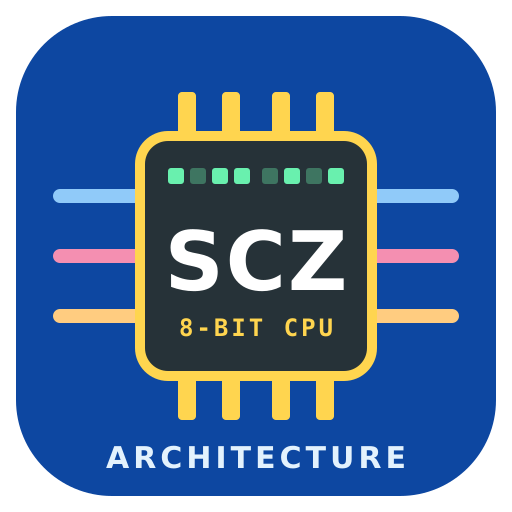
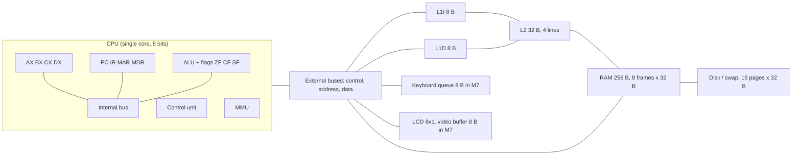
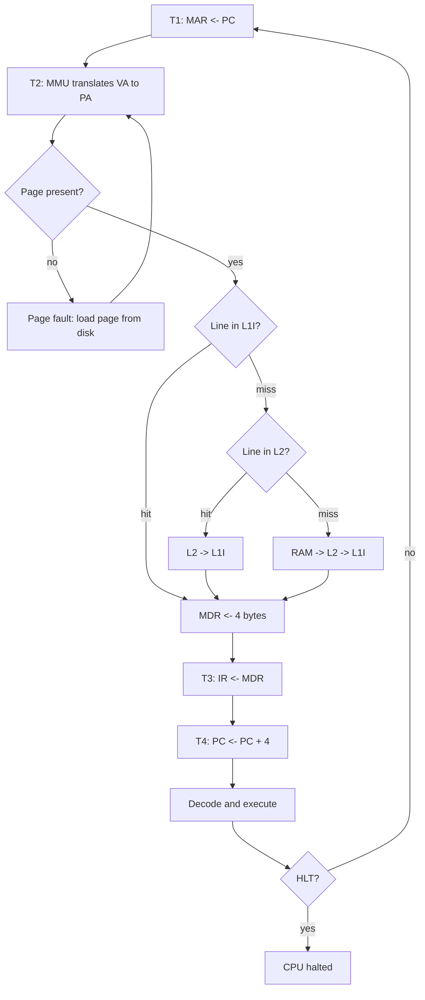
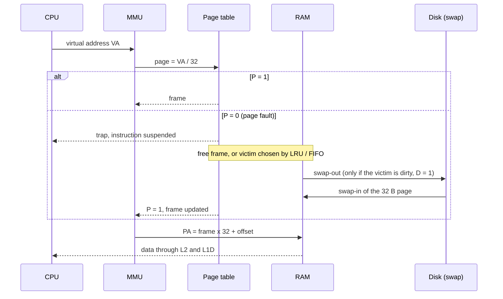

<p align="center"></p>
<p align="center"><b>Team SCZ-Architecture</b> · Josue Cartagena · Jussel Avila</p>

# Advanced Computer Architecture Simulator

**SIS-131 Computer Architecture · Second Partial 2/2026 · Universidad Católica Boliviana "San Pablo" (Santa Cruz)**

[🇪🇸 Versión en español](README.md) · 📥 **Spreadsheet:** [`dist/Simulator_SIS131.ods`](dist/Simulator_SIS131.ods)

A LibreOffice Calc workbook with Basic macros that simulates a complete single-core 8-bit computer (1 process, 1 thread) and **animates how every byte moves**: tri-state buses with a control word, L1I/L1D/L2 cache hierarchy, paged virtual memory with page faults and swap, and memory-mapped I/O (keyboard and 8×1 LCD).

## Contents
1. [Architecture](#1-architecture)
2. [Instruction cycle](#2-instruction-cycle)
3. [Memory access and page fault](#3-memory-access-and-page-fault)
4. [Instruction set (ISA)](#4-instruction-set-isa)
5. [Control word (21 signals)](#5-control-word-21-signals)
6. [Memory map](#6-memory-map)
7. [Catalog programs](#7-catalog-programs)
8. [User manual](#8-user-manual)
9. [Setup: enable macros](#9-setup-enable-macros)
10. [Building and testing](#10-building-and-testing)
11. [Repository layout](#11-repository-layout)

## 1. Architecture



| Component | Size | Details |
|---|---|---|
| Data registers | 4 × 8 bits | AX (accumulator), BX (base), CX (counter), DX (data and I/O) |
| Control registers | — | PC (9 bits, virtual address), IR (4 bytes), MAR (9 bits), MDR, flags ZF CF SF |
| L1I / L1D | 8 B each | one 8 B line, TAG = physical base address |
| L2 | 32 B | 4 lines × 8 B, direct mapped: line = (PA ÷ 8) mod 4 |
| RAM | 256 B | 8 frames × 32 B; M0–M6 paged, M7 pinned to I/O page 15 |
| Virtual memory | 512 B | 16 pages × 32 B on disk (swap area) |
| Keyboard | 8 B | circular queue at PA 0xE0–0xE7 |
| LCD 8×1 | 8 B | video buffer at PA 0xE8–0xEF |

**Policies:** demand paging, LRU or FIFO page replacement, write-through caches without write-allocate, and invalidation of every cache line of an evicted frame.

## 2. Instruction cycle



## 3. Memory access and page fault



## 4. Instruction set (ISA)

Fixed 4-byte format: **byte 0** opcode · **byte 1** register (AX=0, BX=1, CX=2, DX=3) · **byte 2** source register or high bit of the address · **byte 3** immediate or low byte of the address. Virtual addresses are 9 bits (0x000–0x1DF).

| Opcode | Mnemonic | Example | Effect | Flags |
|---|---|---|---|---|
| 00 | `NOP` | `NOP` | nothing | — |
| 01 | `MOV r, imm` | `MOV CX, 5` | r ← immediate | — |
| 02 | `MOV r, r2` | `MOV CX, BX` | r ← r2 | — |
| 03 | `MOV r, [addr]` | `MOV AX, [0x040]` | r ← M[addr] through MMU, L1D, L2, RAM | — |
| 04 | `MOV [addr], r` | `MOV [0x042], DX` | M[addr] ← r (write-through, D=1) | — |
| 05 | `ADD r, r2` | `ADD DX, AX` | r ← r + r2 | ZF CF SF |
| 06 | `ADD r, imm` | `ADD AX, 1` | r ← r + imm | ZF CF SF |
| 07 | `SUB r, r2` | `SUB AX, BX` | r ← r − r2 | ZF CF SF |
| 08 | `SUB r, imm` | `SUB CX, 1` | r ← r − imm | ZF CF SF |
| 09 | `INC r` | `INC BX` | r ← r + 1 | ZF SF |
| 0A | `DEC r` | `DEC CX` | r ← r − 1 | ZF SF |
| 0B | `CMP r, r2` | `CMP AX, BX` | r − r2, result not stored | ZF CF SF |
| 0C | `CMP r, imm` | `CMP DX, 0` | r − imm, result not stored | ZF CF SF |
| 0D | `JMP addr` | `JMP NEXT` | PC ← addr | — |
| 0E | `JZ addr` | `JZ DONE` | if ZF = 1: PC ← addr | — |
| 0F | `JNZ addr` | `JNZ LOOP` | if ZF = 0: PC ← addr | — |
| 13 | `JC addr` | `JC BIGGER` | if CF = 1: PC ← addr | — |
| 10 | `IN r, [KBD]` | `IN DX, [KBD]` | r ← next key of the queue; ZF = 1 if empty | ZF |
| 11 | `OUT [LCD], r` | `OUT [LCD], DX` | character → video buffer → LCD | — |
| 12 | `HLT` | `HLT` | stops the CPU | — |

Examples: `MOV BX, 7` → `01 01 00 07` · `MOV AX, [0x040]` → `03 00 00 40` · `HLT` → `12 00 00 00`.

Assembler syntax: `LABEL:` for jumps, `;` comments, numbers in decimal, `0x..`, `..h` or `'c'`, and `.DATA addr, v1, v2, …` to place data.

## 5. Control word (21 signals)

On every micro-step the control unit emits a 21-bit vector, in this order:

`En_PC Ld_PC Ld_MAR Mem_R Mem_W IO Ld_MDR En_MDR Ld_IR En_IR En_ALU Ld_AX En_AX Ld_BX En_BX Ld_CX En_CX Ld_DX En_DX En_KBD Ld_LCD`

| Group | Signals | Meaning |
|---|---|---|
| Output enable (tri-state) | `En_PC`, `En_IR`, `En_MDR`, `En_ALU`, `En_AX`, `En_BX`, `En_CX`, `En_DX`, `En_KBD` | the component drives the bus; **only one at a time**, the rest stay in high impedance (Z) |
| Register load | `Ld_PC`, `Ld_MAR`, `Ld_MDR`, `Ld_IR`, `Ld_AX`, `Ld_BX`, `Ld_CX`, `Ld_DX`, `Ld_LCD` | the component latches the value on the bus |
| Control bus | `Mem_R`, `Mem_W`, `IO` | memory read, memory write, I/O cycle |

Example, `MOV CX, BX`: `En_BX = 1`, `Ld_CX = 1`, every other signal 0 → vector `000000000000001100000` (positions follow the order above).

## 6. Memory map

| Space | Range | Content |
|---|---|---|
| Virtual (disk) | 0x000–0x1FF | 16 pages × 32 B; code starts at 0x000 |
| Physical (RAM) | 0x00–0xDF | frames M0–M6 (paged) |
| Physical (RAM) | 0xE0–0xE7 | keyboard queue (M7) |
| Physical (RAM) | 0xE8–0xEF | LCD video buffer (M7) |

Translation: `page = VA ÷ 32`, `offset = VA mod 32`, `PA = frame × 32 + offset`.

## 7. Catalog programs

| Program | What it shows | Expected result |
|---|---|---|
| **P1 Sequential multiplication** | A × B by repeated addition with AX, BX, CX, DX and a loop; A and B come from the inputs panel | `7 x 5 = 35`, 3 page faults |
| **P2 Keyboard → LCD** | each key travels queue → bus → DX → bus → video buffer → LCD | the typed text on the LCD |
| **P3 Memory fill and swap** | scattered accesses fill the 7 frames and then force replacements | 11 page faults, 3 swap-outs, CX = AA |
| **EDITOR** | free code; sample writes `HOLA` on the LCD | `HOLA` |

## 8. User manual

1. Open `dist/Simulator_SIS131.ods` with macros enabled (section 9).
2. Choose **Speed** (1 = very slow, 5 = instant), **Animate fetch** (YES/NO) and **Page replacement** (LRU/FIFO).
3. Press **P1**, **P2** or **P3**. The program is assembled and loaded into the disk; RAM stays empty.
4. For P1, type A and B in **PROGRAM 1 INPUTS**. For P2, type up to 8 letters in the yellow **KEYBOARD** box.
5. Press **▶ Step** (one instruction) or **▶▶ Run** (until `HLT`). **■ Stop** pauses, **⟲ Reset** reloads.
6. Watch the yellow token on the buses, the HIT/MISS indicators, the page table, the swap timeline and the control word.
7. To change code: edit the lines in the **PROGRAMS** sheet (press Enter in each cell) and load again. Always use labels in jumps.

Colors: blue = data bus, pink = address bus, orange = control bus; every virtual page keeps the same color on disk, in RAM, in the caches and in the timeline.

## 9. Setup: enable macros

1. LibreOffice 7.x or newer.
2. **Tools › Options › LibreOffice › Security › Macro Security** → **Medium**.
3. Reopen the file and choose **Enable Macros**.
4. If the buttons do not respond, turn off **Design Mode** (Form toolbar).

## 10. Building and testing

The workbook is generated from the sources:

```bash
python3 build/build.py          # writes dist/Simulator_SIS131.ods
python3 tests/run_tests.py      # headless regression tests
```

On Windows use the Python bundled with LibreOffice: `"C:\Program Files\LibreOffice\program\python.exe" build\build.py`.

## 11. Repository layout

| Path | Content |
|---|---|
| `build/build.py` | workbook generator (sheets, layout, controls, `Config` constants module) |
| `src/*.bas` | Basic modules, one per feature (Core, Cpu, Isa, Control, ControlWord, Animation, Memory, Mmu, Swap, CacheL1, CacheL2, Keyboard, Lcd, Assembler, Loader, Panel, ProgramWindow) |
| `src/programs/*.asm` | catalog programs |
| `src/data/` | ISA sheet, guide and team data |
| `tests/` | regression tests and expected results |
| `docs/` | delivery checklist |
| `assets/` | logo |
| `dist/` | generated workbook |

Workflow: Gitflow with `main`, `develop` and personal `feature/<student>/<module>` branches, Pull Requests with review and semantic commits; tasks on the GitHub Projects Kanban board.
